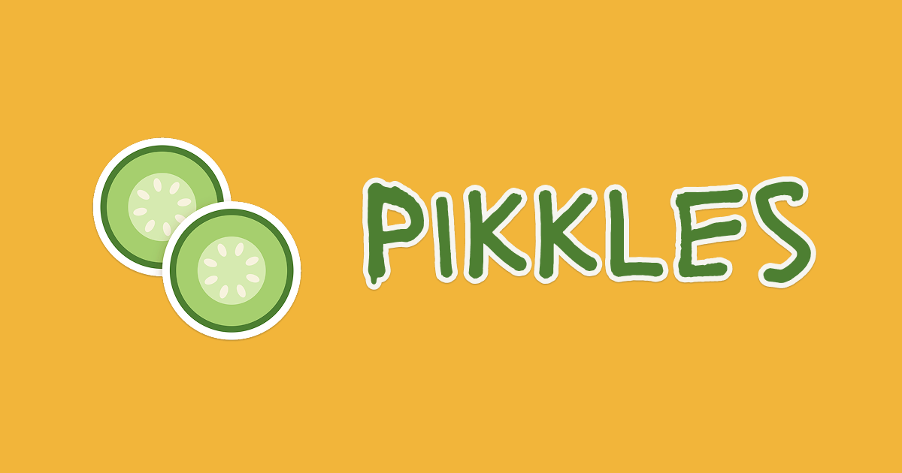

# Pikkles（ピクルス）
URL : https://pikkles.kosora623.com/login
<!-- デモ動画ができたら、サムネイル画像と YouTube のリンクに差し替える -->
[

## 製品概要
### 背景(製品開発のきっかけ、課題等）
SNSの登場から、私たちの身の回りの人間関係は大きく変容しました。
誰かと一緒に過ごした時間を記録することの価値が大きくなり、名前しか知らないような友人が増え、対面で会う必要性や機会が減っていきました。
こうした「人とつながりやすくなったことの弊害」に対して、「スクラップブック」と「Tech」を掛け合わせて「対面で会う」ことを助長するようなSNS、「PIKKLES」を提案します。

### 製品説明（具体的な製品の説明）
撮ったモノと描いたイラストだけがピクルス(ステッカー)になり、会ったその場でピクルスを一つずつ交換できるSNSです。交換は、2人それぞれのBlueskyのデータ置き場（PDS）に「この人と、この場面で会った」記録として残ります。集めたピクルスはビン(シール帳)に入れて飾れます。

### 特長
#### 1. 対面でしか手に入らないステッカー
他人のステッカーをシール帳に貼るには、会ってQRを読み合い、交換する必要があります。
QRコードには60秒の時間制限が設けられており、あえてインターネット上で大量に配布、交換をすることを困難にしています。

#### 2. 交換が2人のPDSに残る
交換という2人の合意を、2人それぞれのPDSに書いた記録の組で表し、サーバーが照合して成立させます。記録は交換日時、交換した場所、ひとことコメントが保存され、いつでも確認することができます。

#### 3. 安心して日常を出せる
背景を消してモノだけにし、位置情報も消します。保存の前に公開されることを確認し、Blueskyのブロックも尊重します。

### 解決出来ること
本プロジェクトでは、解決したい問題に対して「Dip,Pick,Share」という３つのアプローチを提案します。
一つ目の課題は、「人と過ごすなんでもない一瞬を記録したい」というものです。これに対し、「撮影したものをピクルス（ステッカー）にする」ことによって解決します。
二つ目の課題は、「連絡先やSNSはあるけれど、その人の記憶はない」というものです。交換して、そのあと放置されてしまった人間関係はたくさんあることと存じます。これに対し、「交換するものをビンから選ぶ」ことで解決します。ピクルスを保存する「ビン」を眺め、人間関係をあらためて見つめなおす機会とします。
三つ目の課題は、「SNSの発達によって、対面で会うことが減った」というものです。人間関係が手軽になったことで、逆に人間関係に割ける時間が減少しているという問題です。これに対し、「対面での交換で思い出をシェア」することで解決します。ピクルスのシェアを口実に様々な人と対面で出会うことができるようサポートしたいと考えています。

### 今後の展望
- 多言語対応
- 動作の軽量化

### 注力したこと（こだわり等）
* 交換の成立を、サーバーのDBではなく2人のPDSにある記録の照合で決めたこと
* 

## 開発技術
### 活用した技術
#### API・データ
* AT Protocol（Bluesky）：OAuth ログイン、PDS への読み書き、サービス認証（`com.atproto.server.getServiceAuth`）
* 独自の Lexicon `com.kosora623.pikkles.*`（ステッカー、シール帳、交換、共同フィールド、ほしい）

#### フレームワーク・ライブラリ・モジュール
* フロント：TypeScript、React（Vite）、`@atproto/api`、`@atproto/oauth-client-browser`、qrcode。Vercel で公開
* サーバー：Python、FastAPI、WebSocket、`atproto`（JWT の検証・DID の解決）、rembg（u2netp）、Pillow。Render で公開

#### デバイス
* iPhone、Android端末

### 独自技術
#### ハッカソンで開発した独自機能・技術
* **対面交換を2人の PDS の記録の組で成立させる仕組み**（一番力を入れた部分）
  * 交換セッション、QR の合言葉（60秒で失効）、WebSocket での選択・確定の同期、2人の PDS から記録を読んで照合する成立判定、Bluesky のブロックの確認：[f0fad93](https://github.com/jphacks/tkb_2621/commit/f0fad93a7a59ccd1253631ff9543a09fd6a6a9f5)（[backend/app/exchange.py](backend/app/exchange.py)、[backend/app/pds.py](backend/app/pds.py)）
  * 交換画面：QR の表示、参加、選ぶ・確定、自分の PDS への記録と成立の通知：[8dac211](https://github.com/jphacks/tkb_2621/commit/8dac211b890853cd5ed9fb4cff142d74bddc06dc)（[frontend/src/components/ExchangeRoom.tsx](frontend/src/components/ExchangeRoom.tsx)）
* **ブラウザで得た JWT をサーバーが検証するサービス認証と did:web**：[a4d9d50](https://github.com/jphacks/tkb_2621/commit/a4d9d505c82c318eeddf19a09f97a0cd40cbbb35)（[backend/app/auth.py](backend/app/auth.py)）
* **撮影からステッカー化・公開の確認・PDS への保存**：[fc82fad](https://github.com/jphacks/tkb_2621/commit/fc82fad6b71cda34f07a5b0be3d7988c65b2238a)
* Bluesky の OAuth ログインと PDS の読み書き：[343448a](https://github.com/jphacks/tkb_2621/commit/343448aadc5c5ec5ec80473b39039972c669c747)

Hack Day 開始前に用意したのは開発環境（AGENTS.md、仕様書）だけで、プロダクトのコードはすべて Hack Day 中に書きました。
